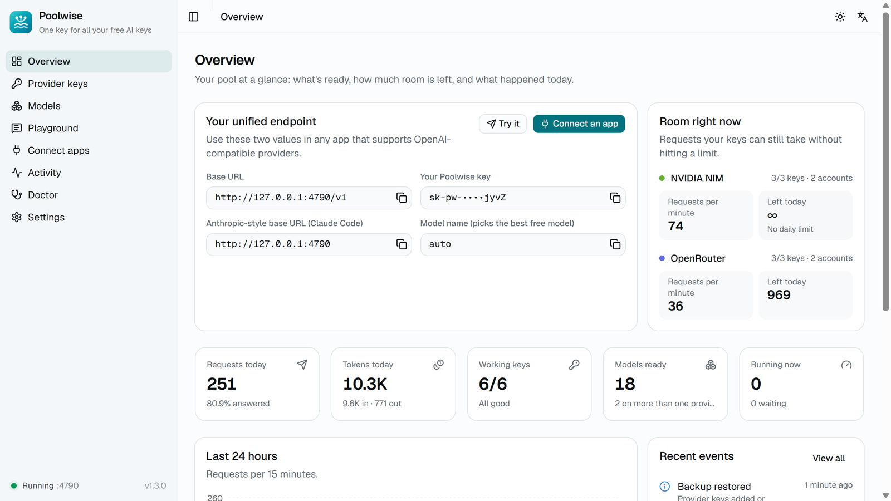
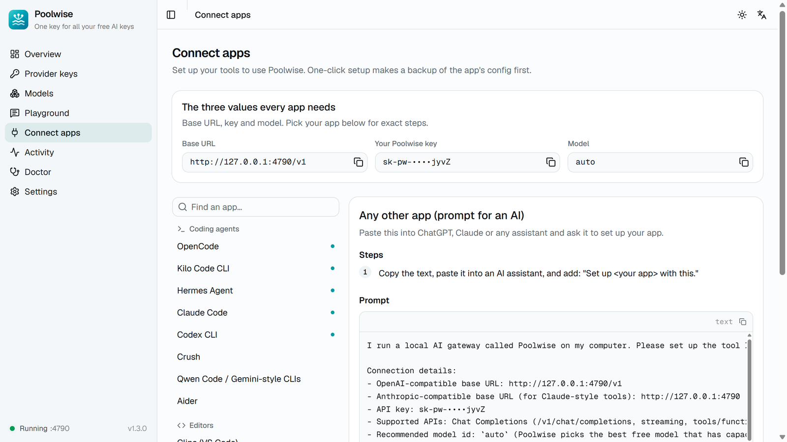
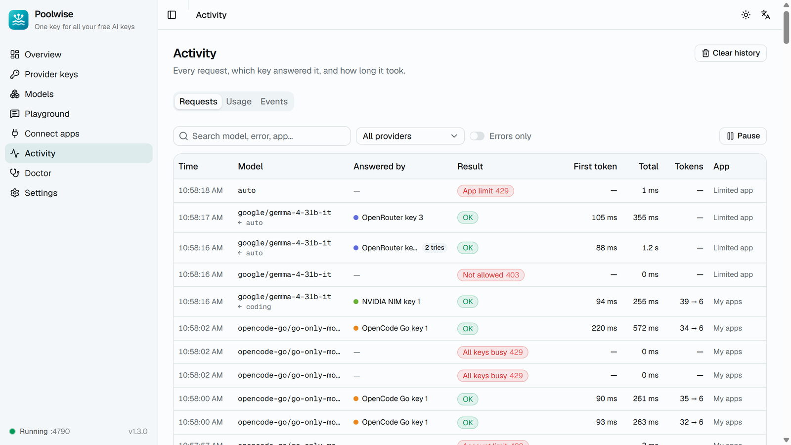

# Poolwise - Windows Installer

**One address and one key for all your free AI keys.**

Poolwise runs on your PC and puts your NVIDIA NIM and OpenRouter keys behind one OpenAI-compatible
address and one key. Your apps (Claude Code, Codex, OpenCode, Hermes, Continue, Open WebUI, your own
scripts) talk to Poolwise; Poolwise picks a key that still has room, moves to the next one *before* a
limit is reached, and works around keys or models that stop answering.



<sub>Screenshots: a test instance on port 4790 running against the project's mock providers, so no real keys or traffic. A normal install listens on port 4747.</sub>

| File | Size | SHA-256 |
|---|---|---|
| `Poolwise_1.3.0_x64-setup.exe` (1.3.0) | 7,917,872 bytes | `AD8C61CB7BAA3A1E3461B9C585F0FDCA7D7C1E4E2233FFBB13A5802AC3E0F06C` |

Download it from the [latest release](https://github.com/abbashkyt-creator/Poolwise-Windows/releases/latest).

## What it does

- **Stays under every known limit.** Each request is counted per key and per account, per minute and
  per day, with a safety margin, so your apps don't run into 429s from limits that are published.
- **Learns the limits nobody publishes.** NVIDIA throttles below its "up to 40 RPM"; Poolwise starts
  lower and measures the real ceiling per key and per model.
- **Doesn't hang.** A stuck or silent request is noticed and retried on another key or provider before
  your app sees anything; healthy long pauses are learned per model so they are not cut off.
- **Speaks three API dialects.** OpenAI Chat Completions (`/v1/chat/completions`), the Anthropic
  Messages API (`/v1/messages`, used by Claude Code) and the OpenAI Responses API (`/v1/responses`,
  used by Codex).
- **Easy to use.** Setup wizard, live dashboard, one-click setup for popular apps, copy-paste settings
  for anything else, Doctor page, English and Arabic.



## Requirements

- Windows 10 or Windows 11 (x64)
- Nothing else to install (the WebView2 runtime is part of Windows 11 and is installed by the setup on
  Windows 10 when missing)

## Install

1. Download `Poolwise_1.3.0_x64-setup.exe` from the release.
2. Run it. Windows SmartScreen warns because the installer is not code-signed with a paid certificate -
   choose **More info -> Run anyway**.
3. It installs for your Windows user only, so it does not need administrator rights. The installer and
   the app are in English and Arabic.
4. The setup wizard opens: paste your own keys, run the one-message test, and connect an app.

The settings every OpenAI-compatible app needs:

| Setting | Value |
|---|---|
| Base URL | `http://127.0.0.1:4747/v1` |
| API key | your Poolwise key (`sk-pw-...`, on the **Overview** page) |
| Model | any id from the **Models** page, or `poolwise/auto` |



## Privacy and security

- Poolwise listens only on `127.0.0.1` unless you turn on network access.
- Provider keys are stored encrypted; the master key lives in the Windows Credential Manager, not next
  to the data. Keys are never written to logs and are shown masked.
- Prompts and answers are not stored unless you turn on **Keep request bodies** (Settings > Privacy,
  off by default). Activity keeps the time, model, key label, status, timing and token counts for
  30 days by default.
- Poolwise only contacts NVIDIA, OpenRouter, models.dev (public model data) and, if you add it, your
  OpenCode Go plan.

## Provider terms

Each provider has its own terms of use. Use your own accounts and your own keys: Poolwise is built to
stay inside each provider's limits, not to get around them.

## Updates

This build has no automatic update source. New versions are published as releases of this repository;
run the new installer over the old one and your keys and settings stay.

## Verify a download

```powershell
Get-FileHash .\Poolwise_1.3.0_x64-setup.exe -Algorithm SHA256
```

Compare against the table above.

## بالعربية

يجمع Poolwise مفاتيحك المجانية للذكاء الاصطناعي (NVIDIA وOpenRouter) خلف عنوان واحد ومفتاح واحد على جهازك،
فتستمر تطبيقاتك في العمل حين يبلغ أحد المفاتيح حدّه. يبقى دون حدود كل مزوّد، ويلاحظ الطلبات المعلّقة ويعيدها
عبر مفتاح آخر، وواجهته بالعربية والإنجليزية. شغّل المثبّت، وأضف مفاتيحك أنت، ثم اربط تطبيقك من صفحة «ربط التطبيقات».

## Source

The application source is not published in this repository. This repository carries the installer only.

## License

All rights reserved. This is **not** an MIT-licensed project and no open-source license is granted for
the application or the installer. You may download and install it for personal use. Redistribution,
modification or republishing is not permitted.
